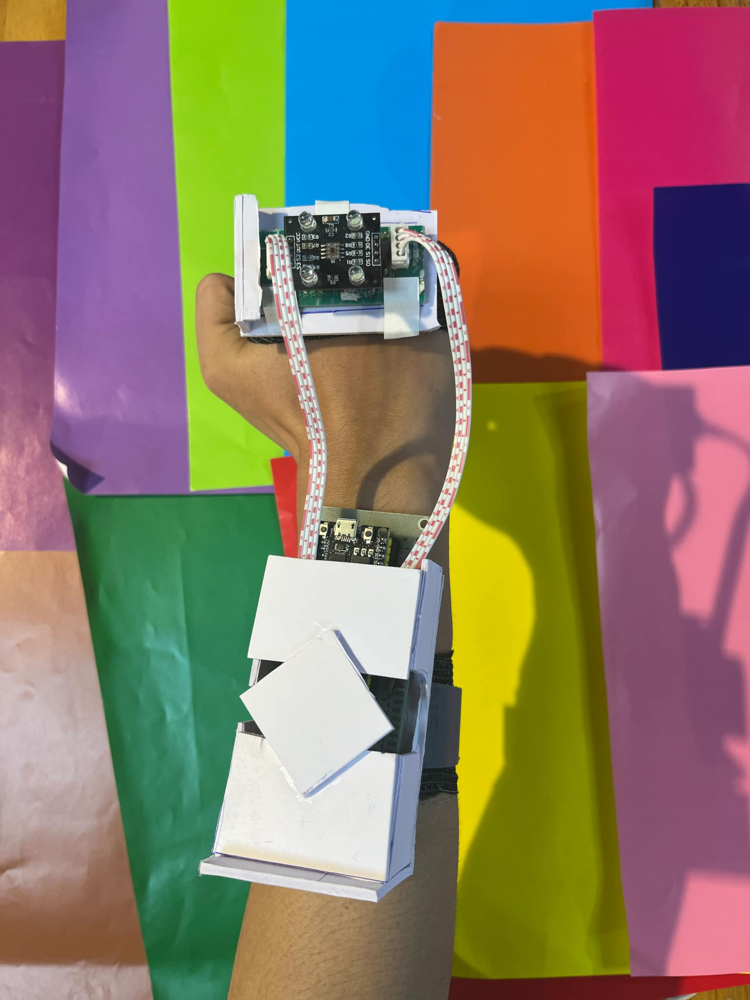
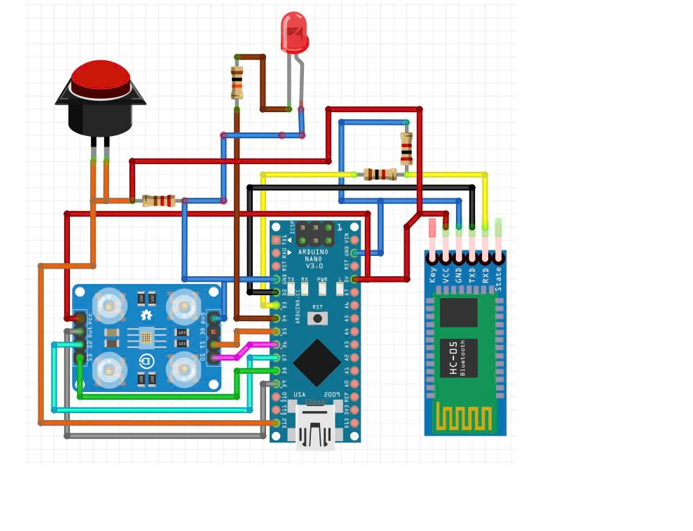
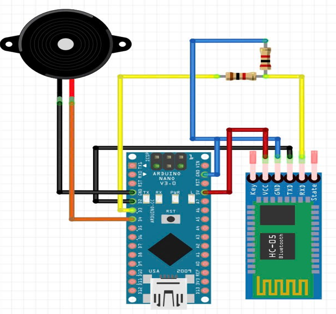

# Color-sensor-for-visually-impaired-people
# Color-Sensing Assistive Device for Visually Impaired Users

An Arduino-based wearable assistive system that detects object colors and converts them into audio feedback for visually impaired users.

## Project Overview

This project was developed to help visually impaired individuals identify colors independently.

The system consists of two wireless modules:

1. A wearable sensing module that detects colors using a color sensor.
2. A Bluetooth-enabled audio module that converts detected colors into distinct sound frequencies.

When a new color is detected, the wearable module transmits the color information via Bluetooth. The receiver module then generates a corresponding audio signal, allowing the user to distinguish colors through sound.

---

## System Features

- Wearable color sensing device
- Wireless Bluetooth communication
- Audio-based color feedback
- Color change detection algorithm
- Low-cost embedded system implementation
- Portable and lightweight design

---

## Hardware Components

### Wearable Sensor Module

- Arduino Nano
- TCS3200 Color Sensor
- HC-05 Bluetooth Module
- Push Button
- LED Indicator

### Audio Feedback Module

- Arduino Nano
- HC-05 Bluetooth Module
- Speaker / Buzzer

---

## System Architecture

---

## Wearable Sensor Circuit

---

## Audio Receiver Circuit

---

## Operating Logic

### Wearable Sensor Module

1. Initialize color sensor and Bluetooth module.
2. Read color data from the sensor.
3. Process and classify the detected color.
4. Compare with the previously detected color.
5. If the color remains unchanged:
   - Do not transmit data.
6. If the color changes:
   - Send color information through Bluetooth.
7. Repeat continuously.

### Audio Feedback Module

1. Initialize Bluetooth communication.
2. Wait for incoming color information.
3. If no new color information is received:
   - Continue monitoring.
4. If a new color is received:
   - Generate the corresponding audio frequency.
5. Continue listening for future updates.

---

## Technical Challenges

- Reducing false detections caused by ambient lighting conditions.
- Minimizing unnecessary Bluetooth transmissions.
- Designing a compact wearable solution.
- Mapping different colors to distinguishable audio feedback.
- Improving accessibility for visually impaired users.

---

## Project Impact

The project was designed to improve accessibility and daily independence for visually impaired users by providing an alternative method for color recognition.

The project received the Outstanding Project Award at the Youth Innovation Hub for its technical implementation and social impact.

---

## Technologies Used

- Arduino IDE
- Arduino Nano
- Embedded C/C++
- Bluetooth Communication
- TCS3200 Color Sensor
- Hardware Prototyping

---

## Author

Nam Trung Ta

Bachelor of Engineering (Engineering Elite Programme)

The University of Hong Kong (HKU)
